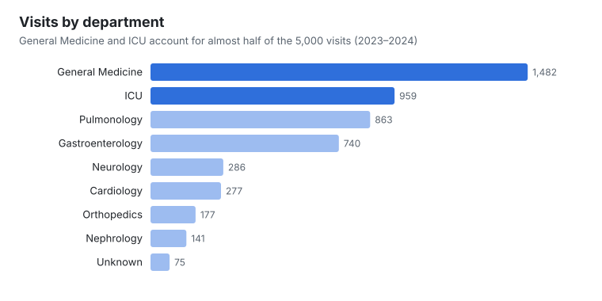
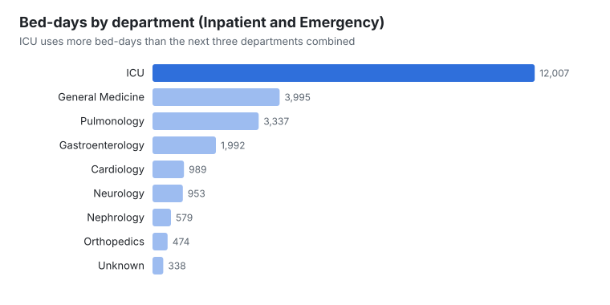
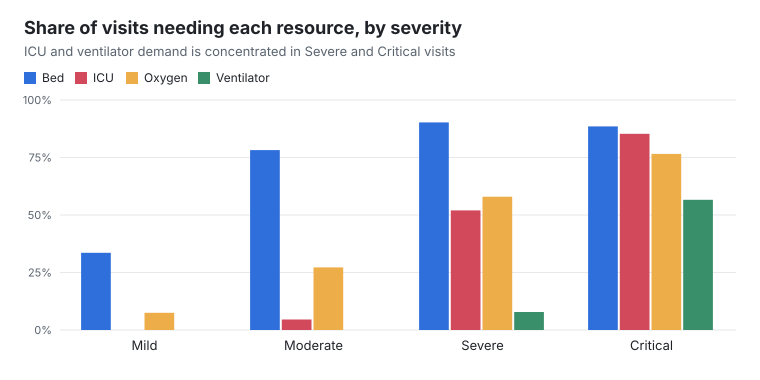
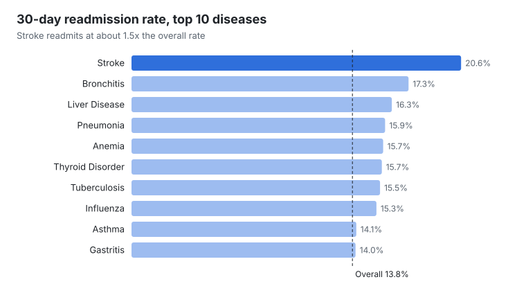

# Hospital Operations Analysis

## Overview

This project uses SQL to analyse hospital visit data, including patient and admission details, recorded resource requirements, and capacity measures.

The workflow begins with profiling the raw data and documenting data-quality issues before defining cleaning rules and conducting exploratory analysis. The analysis focuses on descriptive operational patterns and interprets capacity measures in light of the dataset's limitations.

## Business Objective

The objective is to analyse hospital visit demand and recorded resource requirements, assess what available capacity measures suggest about potential operational pressure, and provide descriptive evidence to support resource allocation and capacity planning.

### Key Business Questions

1. Which departments, diseases and admission types account for the highest hospital visit volumes?
2. How does visit volume vary by month and day of the week, and what seasonal patterns are supported by the data?
3. How does length of stay vary by department, admission type and severity?
4. How do recorded bed, ICU, oxygen and ventilator requirements vary by department, severity and admission type?
5. What do the recorded bed and ICU occupancy measures indicate about potential capacity pressure?
6. What patterns appear in recorded 30-day readmissions by disease, department and severity?

## Dataset

**Source:** Kaggle – Hospital Operations Dataset – Unclean Data

- **Raw:** 5,075 rows, 22 fields, imported into MySQL with every field stored as `TEXT` so no source values were altered on import.
- **Cleaned:** 5,000 visits from 1 January 2023 to 31 December 2024, after removing 75 exact duplicate rows.
- **Grain:** one row per hospital visit. After de-duplication, every visit has a distinct `Patient_ID`.

## Tools Used

- MySQL and MySQL Workbench
- VS Code with SQLTools
- Git and GitHub

## Workflow

| Step | Script | What it does |
|---|---|---|
| 1. Setup | `sql/01_database_setup.sql` | Creates the database and an all-`TEXT` raw table |
| 2. Profiling | `sql/02_raw_data_profiling.sql` | Quantifies duplicates, blanks, label variants, date formats, numeric ranges and logical conflicts |
| 3. Cleaning | `sql/03_data_cleaning.sql` | Builds `hospital_operations_clean` without changing the raw table |
| 4. Validation | `sql/04_cleaning_validation.sql` | Confirms row counts, labels, missing values, capacity limits and flag counts |
| 5. Analysis | `sql/05_exploratory_analysis.sql` | Answers the six business questions |

Every data-quality issue, its evidence and the decision taken are recorded in [`documentation/data_quality_log.md`](documentation/data_quality_log.md).

### Data-quality highlights

- **75 exact duplicate rows** looked like repeat patients at first. Comparing all 22 fields showed they were copies, so they were removed.
- **Inconsistent labels** such as `MALE`, ` Male` and `male` were mapped to one spelling across six fields.
- **Three date formats** (`YYYY-MM-DD`, `DD-MM-YYYY`, `YYYY/MM/DD`) were converted to one `DATE` field.
- **13 rows had a `Month` value that disagreed with `Visit_Date`.** `Season` agreed with the date in every row, so month, day and season are derived from the date.
- **Unusual values were kept and flagged rather than deleted.** These include ages of 0, 110 and 120, OPD visits with stays of up to 120 days, oxygen units of 500–999, ICU without a bed (93) and a ventilator without oxygen (61).
- **`Oxygen_Units_Used` was excluded from patient-level analysis.** 2,876 visits record oxygen units without needing oxygen, which suggests a hospital-level measure.

## Key Findings

### Demand



- **General Medicine (29.6%) and ICU (19.2%) handle almost half of all visits.** Pulmonology is third at 17.3%.
- Inpatient visits are the largest group (38.2%), followed by OPD (33.9%) and Emergency (27.9%).
- **Demand is flat across the period, with no strong seasonality.** Average visits per month range only from 205 (Monsoon) to 212 (Spring and Summer). Day-of-week volumes vary by less than 5%.
- October is the busiest calendar month in both years (228 and 240 visits).

### Length of stay and bed use



- Admitted visits (Inpatient and Emergency) stay an average of **7.64 days**. Emergency stays (9.14 days) are longer than planned inpatient stays (6.39 days).
- **Stay length rises steeply with severity:** Mild 2.0 days, Moderate 4.5, Severe 9.9 and Critical 20.2.
- **ICU accounts for 48.7% of all admitted bed-days.** That is more than General Medicine, Pulmonology and Gastroenterology combined, despite ICU having fewer visits than General Medicine.

### Resource requirements



- Overall, 66.0% of visits need a bed, 30.8% oxygen, 19.5% ICU care and 6.2% a ventilator.
- **Critical visits drive high-intensity demand:** 85.3% need ICU and 56.6% a ventilator, against 7.8% for Severe and 0% for Mild or Moderate.
- **ICU need is recorded only against the ICU department.** All 959 ICU-department visits need ICU, and no visit in another named department does. The ICU flag therefore describes where patients were treated rather than an independent clinical need.

### Capacity

- Recorded bed occupancy averages **66.2%** (peak 89.6%), and ICU occupancy averages **52.2%** (peak 69.7%).
- **Only 1.8% of bed snapshots reach the commonly used 85% planning threshold, and no ICU snapshot does.** Winter has the highest average bed occupancy at 69.4%.
- No recorded occupancy exceeds available capacity.

### Readmissions



- **13.8% of visits** are followed by a readmission within 30 days.
- Severe visits have the highest readmission rate (19.2%). Their rate is higher than Critical (16.5%), Moderate (12.4%) and Mild (11.4%).
- **Stroke (20.6%) and Bronchitis (17.3%)** have the highest readmission rates by disease. Food Poisoning (9.3%) has the lowest.
- ICU has the highest departmental readmission rate at 17.5%.

## Recommendations

1. **Plan ICU capacity on bed-days, not visit counts.** ICU drives about half of admitted bed-days, so small changes in Critical or Severe admissions will move bed demand more than changes in overall visits.
2. **Use severity mix as the early-warning signal for ventilators and ICU.** Ventilator demand comes almost entirely from Critical visits, so a rise in Critical admissions is the trigger to watch.
3. **Target discharge follow-up at Severe patients and stroke.** They combine high readmission rates with long stays (Severe 9.9 days, and stroke the longest of any disease at 11.4 days), so preventing their readmissions frees the most bed time.
4. **Fix the data at source before relying on capacity metrics.** Record occupancy and oxygen use at the hospital-day level in their own table. Validate admission type against stay length, and stop the free-text variants of category labels.

## Limitations

- Occupancy, capacity and oxygen-unit fields appear to be hospital-level snapshots repeated on each visit row. Capacity results describe those snapshots, not each patient's experience.
- The ICU requirement field mirrors the ICU department, so it cannot separate clinical need from where a patient was placed.
- Resource fields show whether a resource was needed, not for how long.
- Readmission records do not show whether a return visit was planned, avoidable or related to the original condition.
- The analysis is descriptive. It identifies associations, not causes.

## Repository Structure

```text
hospital-operations-analysis/
├── data/
│   ├── raw/                  hospital_operations_dataset.csv
│   ├── cleaned/              hospital_operations_clean.csv
│   └── reporting_exports/    hospital_kpi_summary.csv
├── documentation/
│   ├── data_dictionary.csv
│   ├── data_quality_log.md
│   └── project_brief.md
├── images/                   charts used in this README
├── sql/
│   ├── 01_database_setup.sql
│   ├── 02_raw_data_profiling.sql
│   ├── 03_data_cleaning.sql
│   ├── 04_cleaning_validation.sql
│   └── 05_exploratory_analysis.sql
└── README.md
```

## Next Steps

- A Power BI dashboard built on `hospital_operations_clean`.
